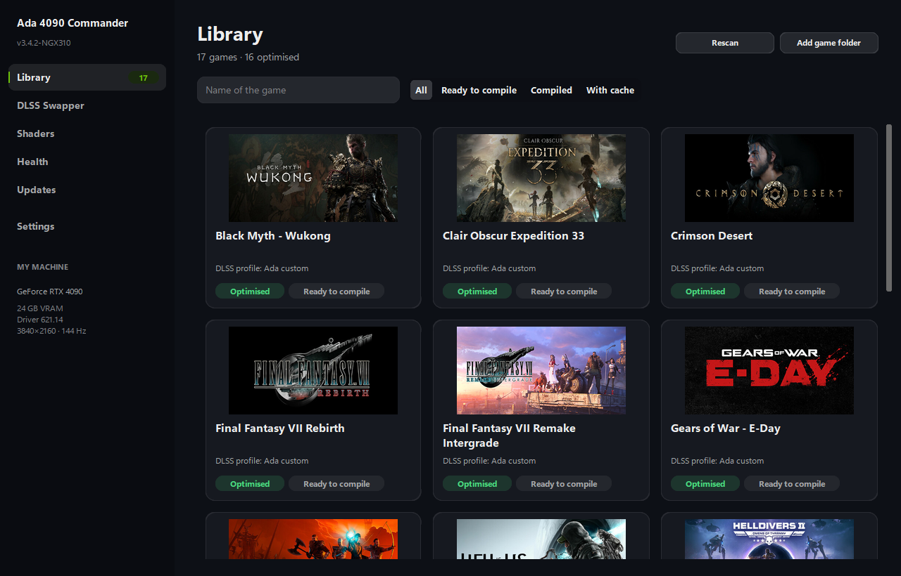
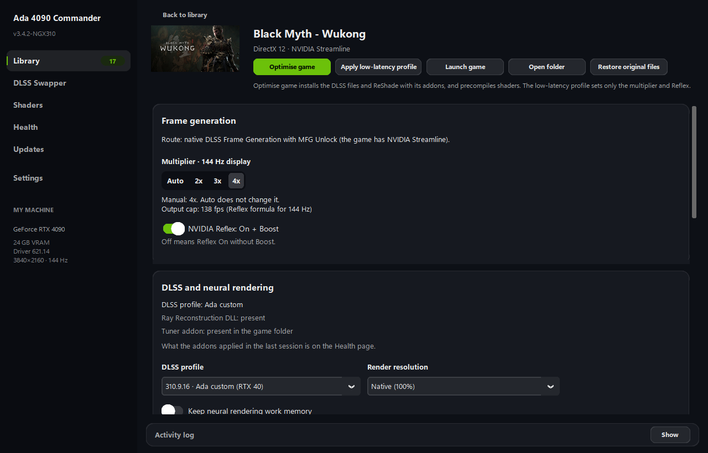

<h1 align="center">Ada 4090 Commander</h1>

  <b>A portable Windows app that installs a DLSS, frame generation and ReShade pack into your PC games, and shows what is really happening in each one.</b>

  
  
  
  

  <a href="#-download-and-install">Download</a> ·
  <a href="#-gpu-hardware-compatibility">GPU compatibility</a> ·
  <a href="#-what-the-app-does">What it does</a> ·
  <a href="#-measured-on-an-rtx-4090">Measurements</a> ·
  <a href="RELEASE_NOTES_v3.4.2.md">Release notes</a>

---

Built and tested on a **GeForce RTX 4090** with a 4K 144 Hz display. Where something has not been measured in a game, this page says so.

  
  

## ✨ New in v3.4.2

- **Neural Rendering runtime 1.8 % faster on RTX 40, same image** (bit-for-bit identical on the bench).
- **MFG Unlock cleaned up:** no XMX generator, a pacing line in the log every 10 s, and two features that never actually ran on an RTX 4090 are fixed and marked experimental.
- **DXR Fast-Trace off by default**; DXR telemetry in the log.
- **New per-game option** to keep the neural network's work memory (off by default).
- **Engine.ini no longer lowers** the texture and shadow quality you chose in the game.
- **A new, sober interface:** the game page shows the settings first and the diagnostics folded away, every page has the same layout, and the buttons say what they do ("Optimise game", "Restore original files"). English everywhere and no claims the app cannot prove.
- **No more waiting forever** when a backup store is damaged.
- **Auto multiplier:** at a full optimisation the app picks 2x, 3x or 4x from the real frame rate of your last session, and caps the output just under the refresh rate (138 fps on 144 Hz).
- **Ray tracing options per game**, off by default: Ray Reconstruction and Hit Lighting through Engine.ini, and ray tracing quality High in Call of Duty.

Full list in the [release notes](RELEASE_NOTES_v3.4.2.md).

## 🎯 GPU hardware compatibility

The pack is built for the RTX 40 series and **only tested on an RTX 4090**. The other rows say what the files contain, not what has been tried.

| Series (architecture) | Models | DLSS 5 Neural Rendering | DLSS presets | Frame generation | Ray tracing (DXR) tuner | Tested |
|---|---|---|---|---|---|---|
| **RTX 40 – Ada** (`sm_89`) *Primary target* | **RTX 4090 / 4090 D** (24 GB) | ✅ Native kernels, 1.8 % faster in v3.4.2 | ✅ SR: K / M / L ✅ Ray Reconstruction: F | ✅ DLSS Frame Generation 2x / 3x / 4x with MFG Unlock (games with Streamline) ✅ NVIDIA Smooth Motion 2x (other games) | ✅ Recursion limit 4 + telemetry | ✅ Built and measured here |
| **RTX 40 – Ada** (`sm_89`) | RTX 4080 Super / 4080 (16 GB) RTX 4070 Ti Super / 4070 Ti / 4070 Super / 4070 (12–16 GB) RTX 4060 Ti / 4060 (8–16 GB) | ✅ Same kernels as the 4090 ⚠️ Cost not measured; expect it to be much higher | ✅ Same presets | ✅ Same as the 4090 | ✅ Same as the 4090 | ⚠️ Not tested |
| **RTX 50 – Blackwell** (`sm_120`) | RTX 5090 / 5080 / 5070 … | ✅ NVIDIA's own kernels, unchanged | ✅ Same presets | ➖ Native multi frame generation; MFG Unlock leaves the game alone | ✅ Recursion limit 4 + telemetry | ⚠️ Not tested |
| **RTX 30 – Ampere** (`sm_86`) | RTX 3090 Ti … 3060 | ⚠️ Kernels included, never run by us | ✅ Same presets | ➖ No DLSS Frame Generation on this series (NVIDIA requirement) | ✅ Recursion limit 4 + telemetry | ⚠️ Not tested |
| **RTX 20 – Turing** (`sm_75`) | RTX 2080 Ti … 2060 | ⚠️ Kernels included, never run by us | ✅ Same presets | ➖ No DLSS Frame Generation on this series (NVIDIA requirement) | ✅ Recursion limit 4 + telemetry | ⚠️ Not tested |

**Sized to your VRAM** (Unreal Engine games, "Tune Engine.ini"): texture streaming pool of 14336 MB with 22 GB or more, 9216 MB with 15 GB or more, 6656 MB with 11 GB or more, 4096 MB with 7 GB or more; not written below that.

> Earlier versions of this page listed an "L2 cache optimization" column, "SER clamping" and different frame generation limits per model. None of that existed in the files: no setting controls the GPU's L2 cache, an addon cannot turn on Shader Execution Reordering, and the multipliers are the same on every RTX 40.

## 🧭 What the app does

| Page | What it does |
|---|---|
| **Library** | Finds installed games and shows, for each one, whether the pack is installed and which profile is detected. |
| **DLSS Swapper** | Switches a game between the pack's DLSS profiles. |
| **Shaders** | Precompiles a game's shaders with scskiller, a bundled third-party tool. |
| **Health** | Reads the game's `ReShade.log` and shows what it proves about the last session, quoting the log line. Anything the log cannot prove is shown as "Cannot be known". |
| **Updates** | Lists this repository's published releases. It never downloads or installs anything. |
| **Settings** | Windows multimedia scheduler, NVIDIA shader cache size, activity log and the online update check switch. |

Opening a game shows its **game page**: graphics API, whether NVIDIA Streamline is present, the DLSS DLL versions in the game folder, an anti-cheat notice when one is detected (it never blocks anything), and the cards below.

### 🛟 Safe deployment and Restore
Before the first write, the app keeps the original of every file it touches in `_4090_Original` inside the game folder. **Restore** returns the game to those originals, even after several deployments, and undoes the app's Engine.ini lines and its NVIDIA driver profile change. The Restore report lists what was returned, says when it gives back a DLSS DLL of uncertain origin to a game that does not use DLSS, and names the files for which no original was kept.

### 🎞️ Frame generation route, chosen per game
- **Games with NVIDIA Streamline:** DLSS Frame Generation with MFG Unlock (multipliers above 2x on RTX 40) and a frame rate cap through Reflex when VRR is active (refresh rate minus 2.8 %, 139.96 FPS on 144 Hz). The route is "native" only when a Streamline DLL is really on disk, and the game page says which file decided it. **Auto** picks 2x, 3x or 4x at a full optimisation from the real frame rate of the last session: the smallest multiplier that reaches the output cap. The cap comes from the refresh rate seen in the log (138 fps on 144 Hz). If the cap was already limiting the last session, Auto keeps the current multiplier, because the real base rate cannot be known. A multiplier you pick by hand is never changed. A game optimised with an earlier version keeps the 2x or 4x it had; the old default, 3x, becomes Auto, and the game page shows what Auto will write before it does.
- **Games without Streamline** (for example Final Fantasy VII Remake): **NVIDIA Smooth Motion**, the driver's own 2x. If you own Lossless Scaling, the app can start it with the game; it generates frames only if it is set up for that game.

On deployment the app may change **Smooth Motion** in that game's NVIDIA driver profile only: on for games without Streamline, off for games with DLSS Frame Generation when it only comes from your global setting. It never changes the global setting, never writes while the game runs, and Restore puts the profile back. No administrator rights needed.

### 🛠️ Engine.ini (Unreal Engine games)
- The app finds the game's own `Engine.ini` by exact project name; if unsure, it asks instead of writing. Games that are not Unreal show no Engine.ini controls.
- "Tune Engine.ini" writes `t.MaxFPS=0`, `r.DynamicRes.OperationMode=0` and the streaming pool for your VRAM. `sg.TextureQuality=3` and `sg.ShadowQuality=3` are written only if your in-game setting is lower.
- **Ray tracing bounces** (Game default / High / Ultra), offered only when the game's executable has the setting. Default: Game default. Effect not measured.
- The card shows each line as it is in the file, and who set it.
- **Ray tracing options per game**, all off by default: Ray Reconstruction and Hit Lighting (written to Engine.ini) and ray tracing quality High (Call of Duty). Each one is offered only when the game shows it reads the setting, and the game page says "Not proven in a game session yet" until the game's log proves the effect. Restore puts back what was there before.

### 🧠 Neural rendering work memory (off by default)
The per-game option **Keep neural rendering work memory** writes `NRWorksetFreePolicy=1` for the DLSS 5 addon, so it keeps its work sets instead of releasing them after 5 s without use. It may remove hitches when the game switches outputs and uses more VRAM (up to about 0.6 GB per work set at 4K, 8 at most). The addon does not document this setting itself. **Not proven in a game session.** Health counts the work sets created and released in the last session.

### 🔒 Your settings stay yours
Only a full optimisation ("Optimise game" or "Update all games") writes the addons' settings. The multiplier and Reflex selectors write only their own setting, so your in-game panel changes stay. Nothing is written while the game is running.

## 📦 What is in the pack

| File | What it is |
|---|---|
| `nvngx_dlss.dll`, `nvngx_dlssd.dll`, `nvngx_dlssg.dll` | NVIDIA DLSS Super Resolution, Ray Reconstruction and Frame Generation 310.9.16, signed by NVIDIA, unchanged |
| `nvngx_dlssnr.dll` | Custom build of NVIDIA's 310.9.16 Neural Rendering runtime with native kernels for RTX 20, 30 and 40. Not signed by NVIDIA; network weights unchanged. New in v3.4.2: the RTX 40 kernels no longer wait after each memory copy; the kernels for RTX 20, 30 and 50 are byte-for-byte the same as in v3.4.1 |
| `ada4090-sm89-tuner.addon64` | ReShade addon: DLSS presets (K for DLAA to Balanced, M for Performance, L for Ultra Performance, F for Ray Reconstruction), `DLSS.Use.Folded.Network = 1`, Frame Generation creation settings, a ray tracing recursion limit of 4 (`DxrRecursionClampDepth=0` turns it off for a game) and DXR telemetry in the log. **DXR Fast-Trace is off by default** (`DxrFastTrace=0`). Its in-game panel says when each setting takes effect |
| `renodx-mfgunlock.addon64` | ReShade addon: Frame Generation multipliers above 2x on RTX 40, the VRR frame rate cap, and a pacing line in the log every 10 s. No XMX generator. The adaptive quality suite and the validated blend are **experimental and off by default**: turning them on changes the generated frames, which has not been checked in a game |
| `renodx-dlss5.addon64`, `dlss5-feed.addon64`, `dxgi.dll` (ReShade 6.8.0), `scskiller\` | Third-party binaries |
| `THIRD-PARTY-NOTICES.txt` | Licences of the bundled third-party components |

## 📊 Measured on an RTX 4090

**In a game.** Final Fantasy VII Remake, 4K, two network passes: about 14.2 ms of GPU time for the whole neural feed at scale 0.67, against 24.9 ms at 1.00 (measured with v3.4.1).

**On a bench.** v3.4.2 was measured with a bench that runs the NVIDIA runtimes without a game (synthetic 4K input, Final Fantasy VII Remake's settings; it reports GPU time per evaluation and a hash of the output). Nothing in this block was measured in a game.

- **Neural Rendering runtime:** output bit-for-bit identical to v3.4.1 over 66,000 evaluations, at four resolutions and under GPU load, and the whole evaluation 1.78 % faster (15.85 ms to 15.57 ms).
- **DLSS Super Resolution, cost per frame at 4K output:**

| Mode | Preset K | Preset M | Preset L |
|---|---|---|---|
| DLAA | 1.23 ms | 3.68 ms | 4.52 ms |
| Quality | 1.09 ms | 2.00 ms | 2.33 ms |
| Performance | 1.03 ms | 1.38 ms | 1.60 ms |
| Ultra Performance | 1.00 ms | 0.97 ms | 1.09 ms |

- **`DLSS.Use.Folded.Network = 1`** changed neither the cost nor the image of Super Resolution with presets K, M and L.

## 🚧 In development: MFG for Legacy Games (not enabled yet)

Our own frame generation (2x, 3x, 4x) for games without NVIDIA Streamline and without an upscaler, such as Final Fantasy VII Remake. It runs in a separate program that captures the game window and presents the generated frames on top, so nothing is injected into the game.

- **In v3.4.2:** the app already detects which games would use it, and the code is included, but it is switched off and shows no controls. Those games keep NVIDIA Smooth Motion (2x).
- **Measured on a bench without a game, at 4K:** 5.2 ms of GPU time per real frame for 3x under a load like the neural network's (3.9 ms for 2x, 6.3 ms for 4x); generated frames 6 dB (SDR) to 9 dB (HDR) better than a plain blend; scene cuts detected 10 out of 10.
- **Tested on a real 4K 144 Hz display with a test image, not a game:** 2x, 3x and 4x keep a regular rhythm from 46 and 34 fps sources, in SDR and HDR, with no wrong frames. The overlay itself adds under 1 ms; from the source's frame to ours on screen it is 9 to 12 ms in the worst 1 %.
- **What is missing:** the integration in the app, a check that the overlay keeps VRR, and a test in a game. Planned for v3.4.3. Because it works from the final image only, it adds latency (25 to 30 ms at 3x in our estimate, not measured) and cannot match DLSS Frame Generation.

## 🚫 What this pack does not do

- **No setting controls the GPU's L2 cache.**
- **It does not make DLSS Super Resolution, Ray Reconstruction or Frame Generation faster.** Those runtimes are NVIDIA's own files; recompiling their RTX 40 kernels gives the same binaries.
- **No "SER clamping".** Shader Execution Reordering is used by a game's own shaders; an addon cannot turn it on.
- **Tuner settings are not instant.** Settings of its DLSS section apply when the game creates DLSS (at start, or when you change resolution or DLSS mode in the game's menu); DXR settings apply after restarting the game.

## ⚠️ Requirements and safety

- Windows 10 or 11 and an NVIDIA GeForce RTX card; see the compatibility table. Only tested on an RTX 4090.
- **Do not use the pack in online games with anti-cheat.** ReShade and its addons inject into the game.
- Portable: extract it into a folder you can write to, not under Program Files.

## 📥 Download and install

1. Download **`Ada4090Commander_v3.4.2_NGX310_Portable.zip`** from the [latest release](https://github.com/sellerengine-app/Ada4090Commander-Portable/releases/latest).
2. Extract it into a new folder.
3. Run **`Ada4090Commander.exe`**.

Release notes of every version: [v3.4.2](RELEASE_NOTES_v3.4.2.md) · [v3.4.1](RELEASE_NOTES_v3.4.1.md) · [v3.4.0](RELEASE_NOTES_v3.4.0.md) · [v3.3.12](RELEASE_NOTES_v3.3.12.md) · [v3.3.11](RELEASE_NOTES_v3.3.11.md) · [v3.3.10](RELEASE_NOTES_v3.3.10.md) · [v3.3.9](RELEASE_NOTES_v3.3.9.md) · [v3.3.8](RELEASE_NOTES_v3.3.8.md)
