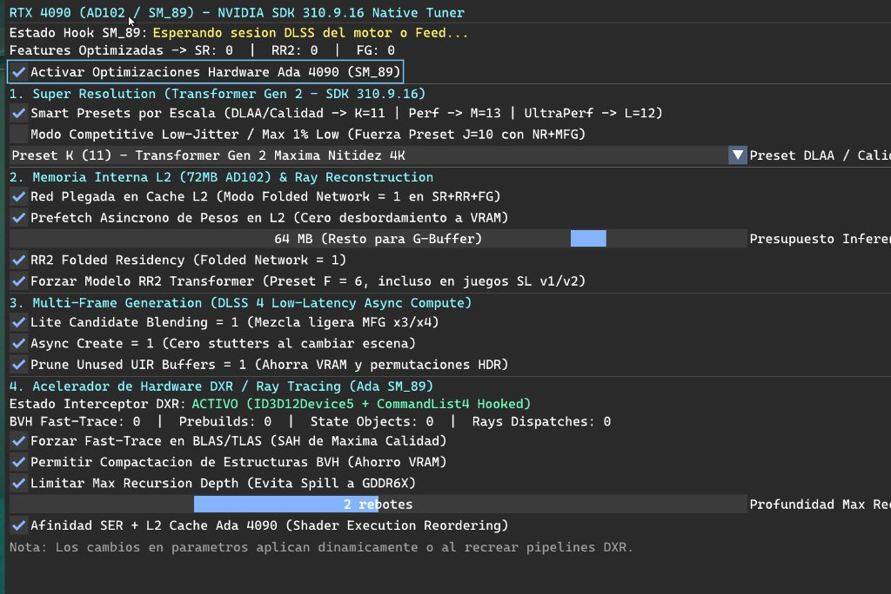

# ⚡ Ada 4090 Commander & SM_89 Native Tuner (v3.3.10 Portable)

Distribution package for **Ada 4090 Commander**, an independent standalone optimizer designed specifically for the **NVIDIA GeForce RTX 4090 (AD102 / SM_89)**.

This utility eliminates software-level pipeline bottlenecks, forces DLSS neural network weights into the **72 MB L2 internal on-chip cache**, accelerates **DXR Ray Tracing at the hardware level (Forced BVH Fast-Trace & SER Clamping)**, enables **Transformer Gen 2 Presets (K/M/L)**, synchronizes the **official NVIDIA NGX SDK 310.9.16 suite**, and unlocks **DLSS 4 Low-Latency Multi-Frame Generation (MFG)** with asynchronous compute for DirectX 12 and Vulkan.

---

## 🎮 In-Game Native Tuner Overlay

---

## 🆕 What's New in v3.3.10

* **⚡ Smart DXR Auto-Detect & Low-Level Hardware Accelerator (Ada SM_89)**:
  * **Zero-Overhead Standby Mode**: Starts in safe passive standby for games without hardware DXR (e.g. *Kingdom Come II* using CryEngine SVO voxel GI) to prevent unnecessary driver overhead.
  * **Automatic Silicon Acceleration**: Automatically engages full Ada SM_89 hardware acceleration the exact moment a game engine issues its first DXR Ray Tracing call (*Black Myth: Wukong* Path Tracing, *Cyberpunk 2077* RT Overdrive, *Call of Duty* RT Sun Shadows).
  * **Hardware Scratch Overflow Guard**: Strictly protects against out-of-bounds GPU scratch memory writes, completely eliminating `DXGI_ERROR_DEVICE_HUNG` / `DEVICE_REMOVED` TDRs when engines allocate smaller scratch buffers for dynamic builds.
  * **VMT Interception**: Detours `ID3D12Device5` (`GetRaytracingAccelerationStructurePrebuildInfo`, `CreateStateObject`) and `ID3D12GraphicsCommandList4` (`BuildRaytracingAccelerationStructure`) with live `OnPresent` swapchain bootstrap.
  * **Trace Recursion Clamping**: Clamps `MaxTraceRecursionDepth` to 2 to eliminate VGPR register spill to GDDR6X VRAM.
* **🎯 Competitive Low-Jitter & Maximum 1% Lows Architecture**:
  * Optimized for competitive gaming and flat frametimes. Binds DLSS Transformer Preset J/K with 72 MB AD102 L2 Folded Network residency and a hard-clamped 140.0 FPS Reflex VRR ceiling for 144 Hz displays.
* **🛡️ Streaming Native DLSS Detection & Script Launcher Support**:
  * **Streaming 32 MB Chunk Scanning**: Scans executables and massive engine DLLs (such as `WHGame.dll` at 88 MB in *Kingdom Come II*) without arbitrary file-size cutoffs, guaranteeing 100% accurate native DLSS classification and preventing accidental feeder collisions.
  * **Smart Script Launcher Integration**: Seamlessly launches games requiring dedicated bootstrap scripts or offline anti-cheat drivers (e.g. `!start_sp26.bat` in *Call of Duty*) when clicking Play.
  * **Bundled High-Resolution Cover Art**: All 18 official game artworks pre-packaged in `_internal/assets/covers` and `assets/covers` for instant visual rendering in the library.
* **🌐 Full English Native UI & Unambiguous Action Controls**:
  * Complete native English interface across all views, telemetry badges, and notifications.
  * Clear action differentiation in Game Detail view:
    * `⚡ Full Suite Deployment (1-Click)`: Complete setup (DLSS Triad, SCSKiller shader precompilation, Engine.ini tuning & Feeder).
    * `🎯 Competitive Low-Jitter Profile (1% Lows)`: Pure frametime pacing refresh (140 FPS VRR clamp, 72MB L2 fold, DXR Fast-Trace without altering engine files).

---

## 🔬 Deep Technical Breakdown of Features & Parameters

### 🎮 In-Game Overlay Controls (`Home` Key)

* **Section 1: Super Resolution (Transformer Gen 2 - SDK 310.9.16)**
  * **Smart Presets by Scale**: Preset K (11) for DLAA & Quality (maximum 4K clarity); Preset M (13) for Performance; Preset L (12) for Ultra Performance.
  * **Competitive Low-Jitter / Max 1% Low**: Enforces Preset J (10) with Neural Reconstruction and Multi-Frame Generation for tighter frame pacing.
* **Section 2: L2 On-Chip Cache (72MB AD102) & Ray Reconstruction**
  * **Folded Network in L2 Cache**: Forces `DLSS.Use.Folded.Network = 1` and allocates 64 MB of L2 SRAM for neural inference weights.
  * **Asynchronous Weight Prefetch**: Prefetches 32 KB tiles in parallel with compute passes.
  * **RR2 Transformer Model (Preset F = 6)**: Enforces Ray Reconstruction 2 across all titles.
* **Section 3: Multi-Frame Generation (DLSS 4 Low-Latency Async Compute)**
  * **Lite Candidate Blending**: Fast motion-vector blending for high-rate generation.
  * **Async Create**: Eliminates stutters during camera cutscenes and scene transitions.
  * **Prune Unused UIR Buffers**: Reclaims VRAM and eliminates redundant HDR permutations.
* **Section 4: DXR Ray Tracing Hardware Accelerator (Ada SM_89)**
  * **Force Fast-Trace on BLAS/TLAS**: Highest SAH build quality for RT Cores Gen 3.
  * **Allow BVH Compaction**: Compresses post-build acceleration structures to save VRAM.
  * **Clamp Max Recursion Depth (2 Bounces)**: Prevents warp register spilling.
  * **SER + L2 Cache Affinity**: Optimizes Shader Execution Reordering for Ada AD102.

---

## 🎯 GPU Hardware Compatibility

| Series / Architecture | Models | DLSS 5 Neural & RR2 | Multi-Frame Gen (MFG) | L2 Cache Optimization | DXR Ray Tracing Accelerator |
| :--- | :--- | :---: | :---: | :---: | :---: |
| **RTX 40 Series (Ada Lovelace)** *(SM_89 / Tier 1 - Primary Target)* | **RTX 4090 / 4090D (24GB)** • AD102 Silicon | ✅ Preset K/M/L + RR2 Preset F | ✅ Native OFA Gen 5 (Up to 6x) | ✅ **72 MB Full** (64MB Inference / 8MB Buffers) | ✅ **Fast-Trace + SER Clamping** |
| **RTX 40 Series (Ada Lovelace)** *(SM_89 / Tier 1)* | **RTX 4080 / 4080 Super (16GB)** • AD103 Silicon | ✅ Preset K/M/L + RR2 Preset F | ✅ Native OFA Gen 5 (Up to 4x) | ✅ **64 MB Adaptive** (54MB Inference / 10MB Buffers) | ✅ **Fast-Trace + SER Clamping** |
| **RTX 40 Series (Ada Lovelace)** *(SM_89 / Tier 1)* | **RTX 4070 Ti Super / 4070 Ti / 4070 Super / 4070** • AD103 / AD104 Silicon | ✅ Preset K/M/L + RR2 Preset F | ✅ Native OFA Gen 5 (Up to 3x/4x) | ✅ **36 MB - 48 MB Adaptive** | ✅ **Fast-Trace + SER Clamping** |
| **RTX 40 Series (Ada Lovelace)** *(SM_89 / Tier 1)* | **RTX 4060 Ti (8GB/16GB) / RTX 4060 (8GB)** • AD106 / AD107 Silicon | ✅ Preset K/M + RR2 Preset F | ✅ Native OFA Gen 5 (Up to 3x) | ✅ **24 MB - 32 MB Adaptive** | ✅ **Fast-Trace Adaptive** |
| **RTX 30 Series (Ampere)** *(SM_86 / Tier 2)* | **RTX 3090 / 3090 Ti / 3080 / 3080 Ti / 3070 / 3060** • GA102 / GA104 Silicon | ✅ Preset K/M + RR2 Preset F | 🔄 Smooth Motion / Companion Mode | ⚠️ Hybrid VRAM Mode (6 MB L2) | ✅ **Fast-Trace Passthrough** |
| **RTX 20 Series (Turing)** *(SM_75 / Tier 3)* | **RTX 2080 Ti / 2080 Super / 2080 / 2070 / 2060** • TU102 / TU104 Silicon | ✅ DLSS Super Resolution + RR | 🔄 Lightweight Interpolation | ⚠️ Standard VRAM Mode (4-6 MB L2) | ✅ **Fast-Trace Passthrough** |

---

### 📦 Installation
1. Download **`Ada4090Commander_v3.3.10_NGX310_Portable.zip`** from the [Latest Release](https://github.com/sellerengine-app/Ada4090Commander-Portable/releases/latest).
2. Extract anywhere (NVMe recommended).
3. Run **`Ada4090Commander.exe`**.
